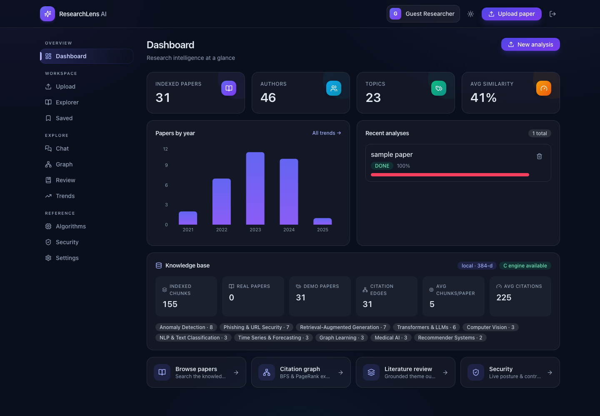
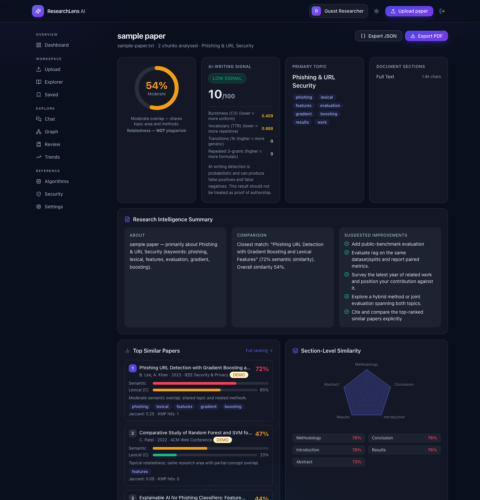
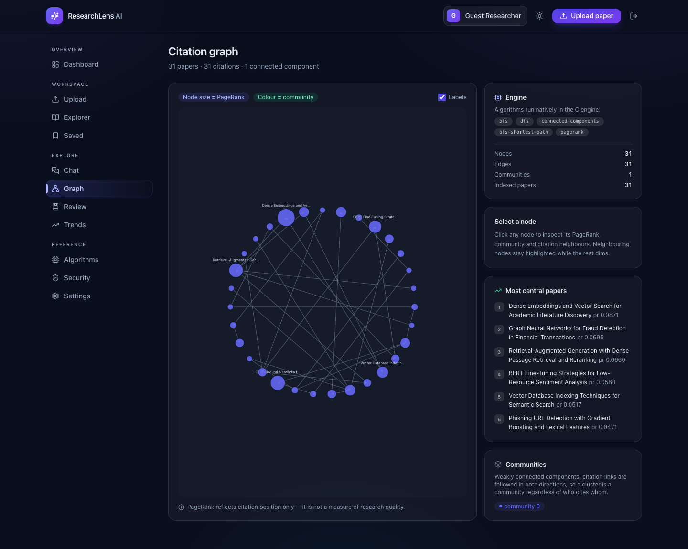
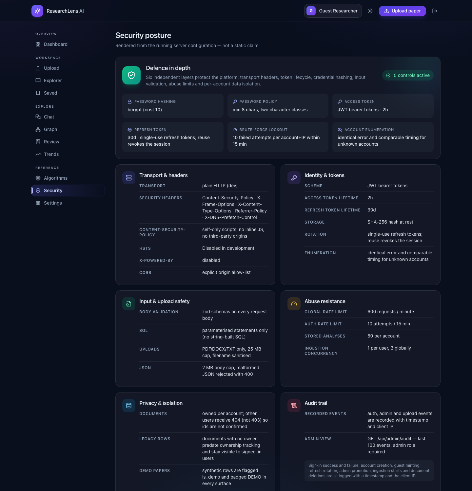
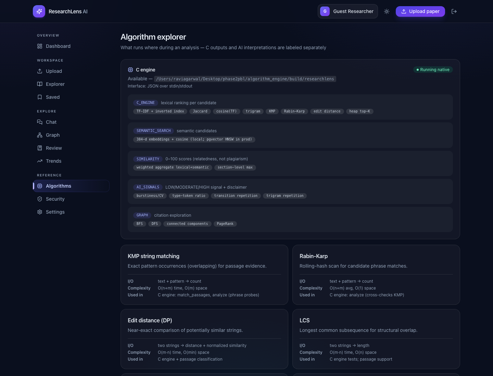
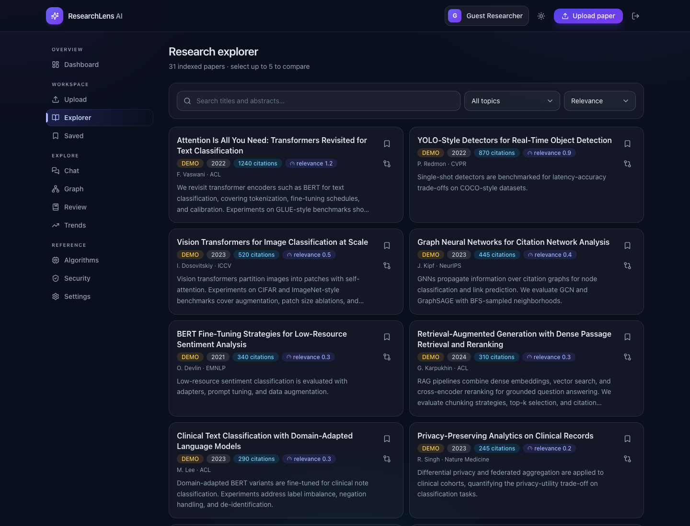
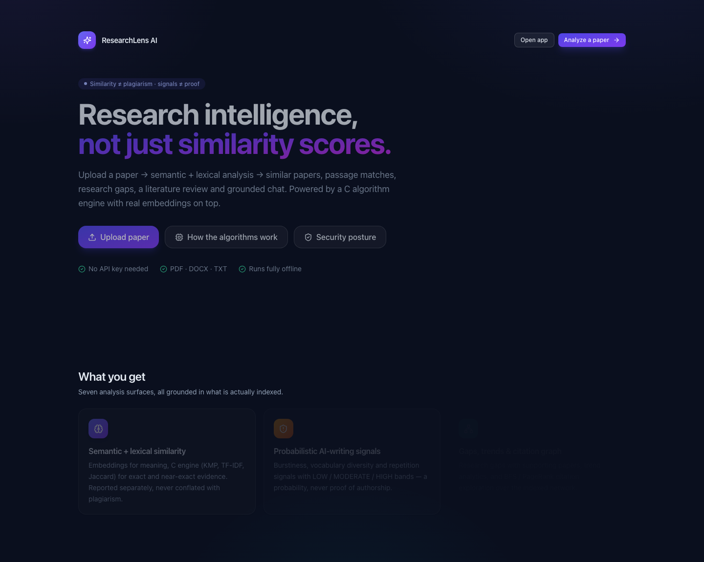
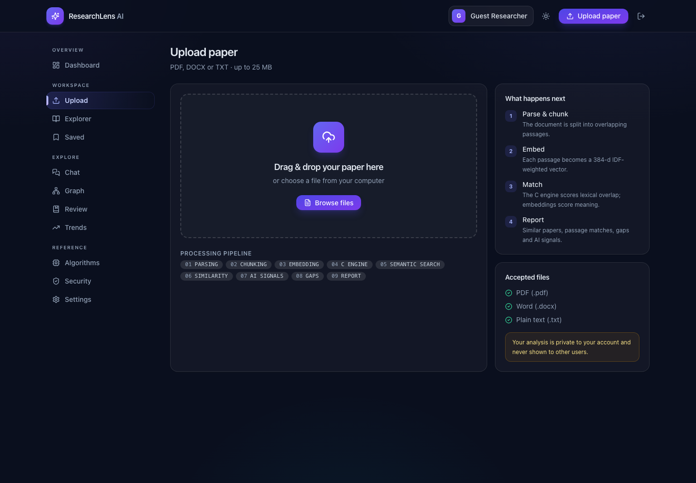
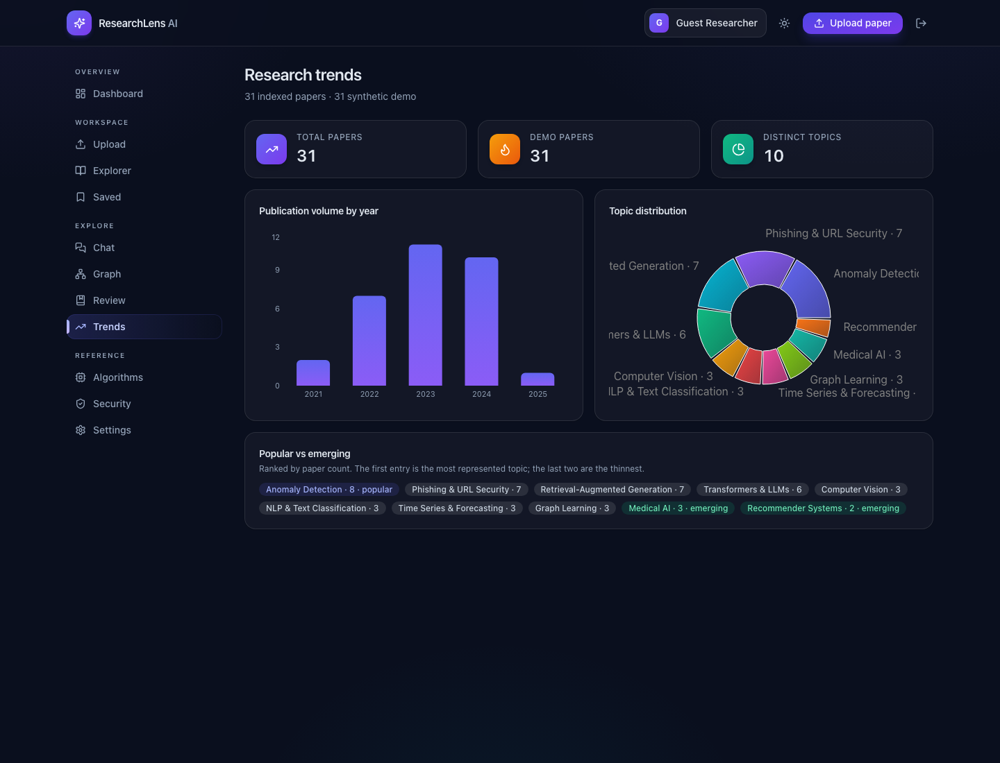
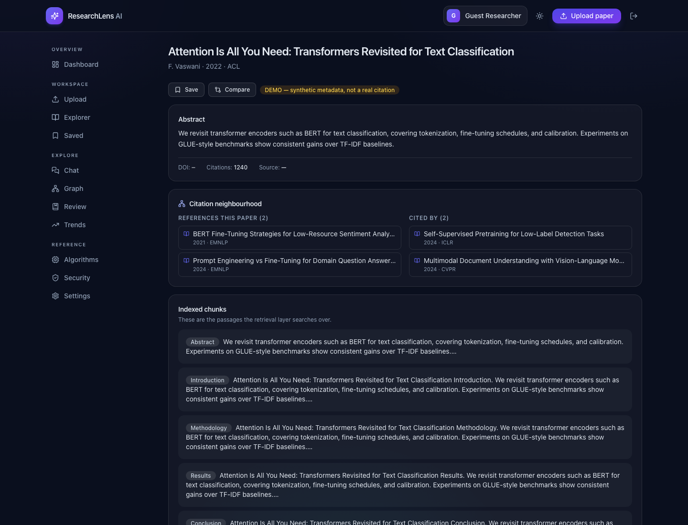

# ◈ ResearchLens AI — AI-Powered Research Intelligence & Similarity Analysis Platform

> Upload a paper → get similar papers, passage matches, AI-writing signals, research gaps, literature review & grounded answers. **Similarity ≠ plagiarism. Signals ≠ proof.**

[](https://researchlens-cqn6.onrender.com)
[](algorithm_engine/tests/test_all.cpp)
[](backend/src/api.test.ts)
[](frontend/src/interaction.test.tsx)
[](docs/DATABASE.md)

**🌐 Live:** https://researchlens-cqn6.onrender.com &nbsp;·&nbsp; **First load takes ~1 min** (free tier wakes from sleep)

---

## What it does

A student uploads a research paper (**PDF / DOCX / TXT**). The platform analyses it against an indexed research knowledge base and returns:

| Output | What you get |
|---|---|
| 📄 Similar papers | Ranked list with scores, section matches & *why-similar* notes |
| 🔍 Passage matches | EXACT / NEAR-EXACT / SEMANTIC / CONCEPTUAL, side-by-side |
| 🤖 AI-writing signals | LOW / MODERATE / HIGH bands + the exact measurements behind them |
| 🕳️ Research gaps | Grounded in retrieved papers, each with a future direction |
| 📚 Literature review | Theme-wise outline citing only retrieved papers |
| 💬 Research chat | RAG answers with evidence — abstains when unsure |
| 📈 Trends & citation graph | Year/topic charts, BFS·PageRank-powered interactive graph |
| 🔬 Compare & ingest | Pairwise paper comparison, live OpenAlex ingestion with citation linking |
| 🛡️ Security posture | Live view of the deployment's own hardening configuration |

## Screenshots

| Dashboard | Analysis report |
|---|---|
|  |  |

| Citation graph | Security posture |
|---|---|
|  |  |

| Algorithm explorer | Research explorer |
|---|---|
|  |  |

| Landing | Upload |
|---|---|
|  |  |

| Trends | Paper detail |
|---|---|
|  |  |

---

## How it works (10-stage pipeline)

```
UPLOAD → PARSE → CHUNK → EMBED → C_ENGINE → SEMANTIC_SEARCH → SIMILARITY → AI_SIGNALS → GAPS → REPORT
```

**Hybrid architecture** — each language where it fits best:

- **C++ engine** (`algorithm_engine/`) — KMP, Rabin-Karp, edit distance, LCS, TF-IDF + inverted index, Jaccard/cosine/trigram, hash table, Trie, heap top-K, BST, graph (BFS/DFS/components/PageRank). JSON stdin/stdout bridge, `make test` + `make asan`.
- **Backend** (`backend/`, Node + TypeScript + Express) — pipeline orchestration, IDF-weighted 384-d embeddings (OpenAI swappable), SQLite dev store, Postgres + pgvector schema for production.
- **Frontend** (`frontend/`, React + TS + Vite + Tailwind) — 19 routes, dark mode, mobile-ready. Shared design system in `index.css` with WCAG-AA text tokens, semantic badges and a five-step button hierarchy.

Lexical (C++) and semantic (embeddings) scores are **reported separately, never conflated**.

---

## Security

Security is a first-class feature, not a checklist — see **[docs/SECURITY.md](docs/SECURITY.md)** for the full write-up. The running server publishes its own configuration at `GET /api/security/summary`, and the **Security** page in the app renders it, so the documentation can never drift from what is enforced.

| Layer | Control |
|---|---|
| Transport | CSP (self-only scripts, no inline JS), `X-Frame-Options: DENY`, `nosniff`, `Referrer-Policy`, HSTS in production, `X-Powered-By` off |
| Identity | Short-lived JWT access tokens + single-use rotating refresh tokens stored as SHA-256 hashes |
| Credentials | bcrypt hashing (cost 12 in prod), password policy (≥8 chars, two character classes), re-hash on policy change |
| Brute force | Per-account+IP lockout window, uniform error **and** comparable timing for unknown accounts (no enumeration) |
| Input | zod schemas on every body, parameterised SQL only, filename sanitisation, MIME + extension allow-list, size caps, malformed JSON → 400 |
| Abuse | Global rate limit, tighter auth rate limit, per-user upload ceiling, per-user and global ingestion concurrency caps |
| Privacy | Documents owned per account; other users get **404, never 403** so ids cannot be probed; legacy ownerless rows stay visible |
| Audit | Logins, failures, guest minting, refresh rotation, admin promotion, ingestion and deletions logged with timestamp + client IP |
| Fail-fast | The server refuses to boot in production with a default or short `JWT_SECRET` |

---

## Quick start (no API keys needed)

```bash
# 0. C++ engine (one-time)
cd algorithm_engine && make test && cd ..

# 1. Backend → http://localhost:4000
cd backend && npm install && npm run migrate && npm run seed && npm run dev

# 2. Frontend (new terminal) → http://localhost:5173
cd frontend && npm install && npm run dev
```

Open the app — a **guest identity is created automatically**, so there is nothing to sign up for before trying it. Upload `backend/seed/samples/sample-paper.txt` (or any PDF) to see the full pipeline.

### Other useful commands

```bash
npm run reembed   # rebuild the search index with the active embedding provider (backend/)
npm test          # all suites: C++ engine + backend + frontend
npm run test:c    # C++ engine only
make -C algorithm_engine asan   # C sanitizer build
npm run build:frontend           # production frontend
```

## Environment

Copy `.env.example` → `backend/.env`. Demo mode needs zero keys.

| Variable | Purpose |
|---|---|
| `EMBEDDING_PROVIDER=openai` + `AI_API_KEY` | Real embeddings (then `npm run reembed` — the re-embed now genuinely uses the provider) |
| `DATABASE_URL` | Postgres production (see `backend/migrations/postgres.sql`) |
| `JWT_SECRET` | **Must** be changed from the dev default before any public deploy — the server refuses to start otherwise. The value is SHA-256 hashed into a 256-bit signing key, so any length is safe |
| `TOKEN_TTL` / `REFRESH_TOKEN_TTL` | Access / refresh token lifetimes (default `2h` / `30d`) |
| `BCRYPT_ROUNDS` | Password hashing cost (default 10, 12 in production) |

## Documentation

| Doc | Contents |
|---|---|
| `docs/ARCHITECTURE.md` | Components, pipeline, scaling notes |
| `docs/SECURITY.md` | Threat model, every control, and how to verify it |
| `docs/DATABASE.md` | Schema, seeding, Postgres portability notes |
| `docs/API.md` | Every endpoint + report shape |
| `docs/AI_ANALYSIS.md` | Honesty contract (similarity, AI signals, grounding) |
| `docs/DSA_IMPLEMENTATION.md` | Every DS/algorithm: complexity, examples, viva notes |

## Honesty contract

1. **Similarity is relatedness, not plagiarism** — only quoted EXACT/NEAR-EXACT overlap warrants a closer look.
2. **AI-writing scores are probabilistic** — false positives/negatives possible, never proof of authorship. The app shows the exact measurements (burstiness CV, type-token ratio, transition density, repeated trigrams) behind every score.
3. **Demo papers are synthetic and badged DEMO** — never presented as real citations; real ingestion uses OpenAlex within rate limits and licensing, and stores the source DOI/URL.

## Deploy

One-click Render blueprint (`render.yaml`): pushes to `main` auto-redeploy in ~3 min, same URL kept. Details in the section above and `docs/ARCHITECTURE.md`.

---

*Built as a college major-project demonstration of C++ & DSA, full-stack engineering, application security, and honest AI measurement.*
